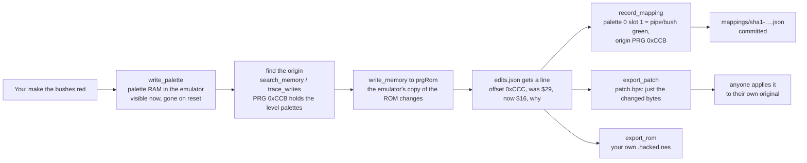

# ROM hacking with jeROMy: what the files are and how a change travels

A learning guide, written 2026-10-05 from Logan's questions. It explains the
five things that look alike and are not (the ROM, a disassembly, the
mapping, the hack, the patch), how one change moves between them, what one
game's files look like on disk, and how several hacks of one game will be
kept apart. Decisions are in `docs/adr/`; this is the plain-language tour.

## The five things

| Thing | What it is | Where it lives | Shared? |
|---|---|---|---|
| **ROM** | The game: Nintendo's bytes, ~40 KB for SMB. PRG (code and tables) and CHR (tile graphics). | Your disk, Windows side. Loaded in Mesen. | Never. jeROMy never ships, fetches or uploads one. |
| **Disassembly** | The whole ROM written out as readable source, every byte present, with names and comments added by a person. Reassembles to the ROM. | `hacks/sha1-<sha1>/reference/`, yours, gitignored (ADR-0017). | Never in this repo: it *is* the ROM in another spelling. The community hosts them; you clone one yourself. |
| **Mapping** | Knowledge about the *original* game: what each tile, palette slot, sprite and address is, and where tables live in PRG. Names, not bytes. | `mappings/sha1-<sha1>.json`, committed. | Yes. This is the community artifact. |
| **Hack** | Your changes: a ledger of ROM byte edits, each with offset, old byte, new byte, reason. | `hacks/sha1-<sha1>/edits.json`, yours, gitignored (ADR-0009). | Yours to share as a project if you want (it contains no game bytes beyond the few you changed). |
| **Patch** | The hack exported in a standard format (IPS or BPS) that patchers and emulators apply to someone's own original ROM. | `hacks/sha1-<sha1>/patch.ips` or `.bps`. | Yes. This is how hacks have always been shared. |

Two more that are not files but matter: **RAM** is the game's working
memory in the emulator, gone on reset; a `write_palette` or RAM write is an
experiment, not a hack. **The emulator's copy of the ROM** is what PRG and
CHR writes change; the file on disk is never touched.

### Mapping versus disassembly

Five real lines from the SMB disassembly, out of 16,290:

```
AreaPalette:
      .byte $01, $02, $03, $04
GetAreaPalette:
      ldy AreaType             ;select appropriate palette to load
      ldx AreaPalette,y        ;based on area type
```

Every byte of the game is in there, in address order, which is why it is
the full blueprint and why it cannot be published by us. Real entries from
a mapping:

```json
"tiles":     { "0x24": { "name": "empty/sky", "category": "background" } },
"palettes":  { "0":    { "name": "sky/ground", "notes": "Shared by clouds, bushes, and ground" } },
"addresses": { "player_x": { "address": "0x0086", "mem_type": "cpu", "description": "Mario's X position" } }
```

The mapping names things and says where they live (`rom_origins: prgRom
0xCCB, 32 bytes`), never what the bytes are. It is organized by what a
person points at (tile, palette, sprite, address), not by address order.
Every entry carries a confidence and, when a reference pointed the way, a
`source`; `confidence: 1` means a session saw it in the emulator. It is
only as large as what hacks have needed so far. The disassembly is the
territory; the mapping is the map with the visited places drawn in.

## How a change travels



The ledger is the only thing that accumulates. `undo_edit 3` removes one
entry and restores its byte. `reapply_edits` replays the list into a
freshly loaded ROM. The patch and the hacked ROM are snapshots regenerated
from the ledger whenever you ask.

### What a patch actually is

The red-bushes hack as an IPS file, byte for byte:

```
50 41 54 43 48   "PATCH"
00 0C DC         offset 0x0CDC  (PRG 0xCCC plus the 16-byte iNES header)
00 01            length 1
16               the new byte
45 4F 46         "EOF"
```

A patcher (Flips, Lunar IPS, a web patcher) opens the other person's
original ROM, walks these records, overwrites those offsets, and saves a
new file. Mesen applies a same-named `.ips`/`.bps` beside a ROM at load.
BPS adds three CRC32 checksums (original, result, patch) so it refuses the
wrong ROM; IPS has no check. Share BPS.

## One game on disk, before ADR-0018 (2026-10-05 morning)

```
mappings/sha1-33d23c….json          the map                     committed
hacks/sha1-33d23c…/                 your hack directory         gitignored
  edits.json                        the ledger (the hack)
  discoveries.json                  mapping entries waiting for promote_mappings
  patch.ips / patch.bps             last export (overwritten each time)
  Super Mario Bros. (World).hacked.nes   last export_rom (overwritten)
  reference/, reference.json        an imported disassembly's names (ADR-0017)
```

One mapping per game. One ledger per game. One patch file, overwritten.
That is enough for one hack and too little for "a game you keep
rewriting", which is release gate 2 (`docs/DIRECTION.md`) and roadmap
item 19.

## Several hacks of one game (ADR-0018, built 2026-10-05)

Suppose you want a Halloween Mario and a Christmas Mario, worked on over
many chat sessions. The shape, as built:

- **A hack is a named directory inside the game's hack directory:**
  `hacks/sha1-<sha1>/halloween/` and `.../christmas/`, each with its own
  `edits.json`, a `hack.json` manifest (name, description, created, the
  versions exported) and its exports as `halloween-v3.bps`, never
  overwritten. The mapping stays one per game: Halloween and Christmas both
  describe the same original.
- **Your hacks root is a git repository of yours**, not jeROMy's. Point
  the plugin's `hacksDir` at it (`~/mario-hacks/` for one game, or
  `~/rom-hacks/` for all your games; the sha1 subfolders keep games
  apart). Commit when you like; git gives history, branches ("try the
  pumpkin pipes on a branch"), and a shareable project containing ledgers,
  manifests and patches but no ROM. One repo per game type is not
  required; the directory layout already separates them.
- **One hack is active in the emulator at a time**, because Mesen shows
  one game. Switching (`use_hack christmas`) reloads the clean ROM and
  replays that ledger; the prompt and the view's status line always name
  the active hack, so every chat session, old or new, sees which project
  it is editing. Sessions share the plugin process, so they share the
  active hack; two chats working on two hacks at once means switching, as
  it would at a real workbench.
- **Booting a hack** applies its ledger when the emulator connects with
  the clean original loaded, announced in the plugin log and the prompt
  (the ledger is the person's recorded instruction; ADR-0018 words the
  rule). Bytes that match neither the old nor the new value are left alone
  and reported as conflicts.

The first time the plugin opens a game directory from before ADR-0018 it
moves the single `edits.json`, `patch.*` and `*.hacked.nes` into
`default/` and writes `game.json` with `active: default`; nothing is lost.

```
~/rom-hacks/                              your git repo (hacksDir)
├── .gitignore                            seeded: *.nes, reference/, *.tmp
└── sha1-33d23c…/                         the game
    ├── game.json                         active: christmas
    ├── discoveries.json                  shared by every hack
    ├── reference.json, reference/        the disassembly's names (ADR-0017)
    ├── default/                          hack 1 (the migrated ledger)
    │   ├── hack.json  edits.json  default-v1.bps
    └── christmas/                        hack 2
        ├── hack.json  edits.json  christmas-v1.bps  christmas.hacked.nes
```

## Glossary

- **PRG / CHR**: the two halves of a cartridge; program and tables / tile
  graphics. SMB has 32 KB PRG and 8 KB CHR.
- **iNES header**: 16 bytes at the start of a `.nes` file, before PRG. A
  PRG offset in the ledger is the file offset minus 16.
- **Tile**: an 8x8 grid of values 0-3 in CHR; the smallest stored picture.
- **Palette slot**: one of four colors a tile's values pick from; 8
  palettes of 4 slots. Changing a slot recolors every pixel of every tile
  drawn with it. The only other way to recolor is to change a tile's
  values (ADR-0014).
- **Nametable**: the 32x30 grid of tile numbers that is the background.
- **OAM / sprite**: the 64 hardware sprites, each one 8x8 (or 8x16) tile
  with its own palette; Mario is several of them.
- **Scroll split**: SMB writes the scroll at scanline 31 so the HUD stays
  put while the level moves (ADR-0010, ADR-0013).
- **sha1**: the fingerprint of the ROM file; every per-game file is keyed
  by it so two dumps of the same game share one mapping.
- **Ledger**: `edits.json`; the hack as a list of byte changes with their
  old values and reasons (ADR-0009).
- **Reference**: a disassembly or wiki you imported for lookups; leads,
  not facts (ADR-0017).
